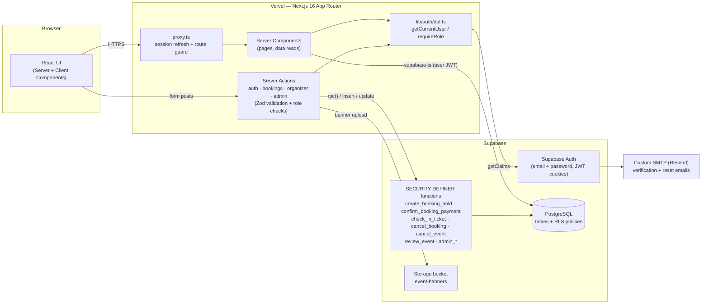
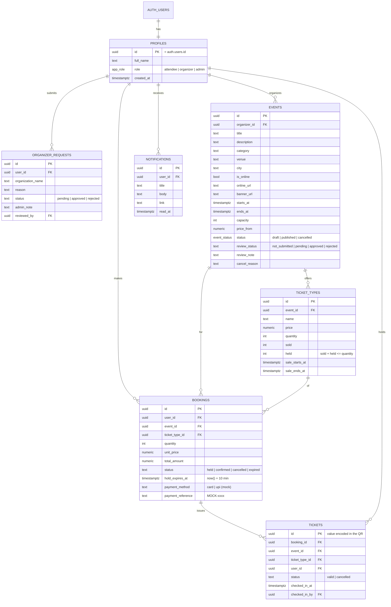

# Architecture

EventSphere is a single Next.js 16 (App Router) application deployed on Vercel.
There is no separate backend server: **Server Components** read data and
**Server Actions** perform writes, both running on Vercel's Node.js functions.
All data lives in **Supabase PostgreSQL**, protected by **Row Level Security**.
Critical operations (seat holds, payment confirmation, check-in, cancellation,
approvals) are **PostgreSQL functions** that lock rows, so they are atomic.

## Architecture diagram



### Key decisions

| Decision | Why |
| --- | --- |
| Next.js Server Actions instead of a separate REST API | One deployment, typed end to end, forms work without client-side fetch code. |
| Supabase Auth with HTTP-only cookies (`@supabase/ssr`) | Passwords are hashed by Supabase (bcrypt); no tokens in `localStorage`. |
| RLS on every table + column-level grants | Users can only read their own bookings/tickets even if they call the API directly. |
| Inventory changes only inside database functions | `UPDATE … WHERE sold + held + qty <= quantity` is atomic, so no overselling; `SELECT … FOR UPDATE` prevents double confirmation / double check-in. |
| QR codes contain only a random ticket UUID | No personal data in the QR; check-in still requires a signed-in organizer of that event. |
| Mock payment inputs have no `name` attribute | Card/UPI fields are never submitted to the server, so nothing is stored. |

## ER diagram



## Folder structure

```text
app/
  (auth)/            login, signup, forgot-password, reset-password
  (app)/             events, checkout, bookings, tickets, notifications, organizer/*
  admin/             admin overview, event approvals, organizer requests, users
  auth/confirm/      email-link handler (verify email, password recovery)
  dashboard/         role-based dashboard + profile actions
components/          UI grouped by feature (auth, bookings, events, organizer, admin, tickets, ui)
lib/
  auth/              Data Access Layer, auth Server Actions, Zod schemas
  bookings/          booking + payment Server Actions
  organizer/         event management + check-in Server Actions
  admin/             admin Server Actions
  supabase/          browser, server and proxy clients
supabase/
  migrations/        versioned SQL (schema, RLS, functions)
  seed.sql           demo events and ticket types
types/               TypeScript types for the database
```
