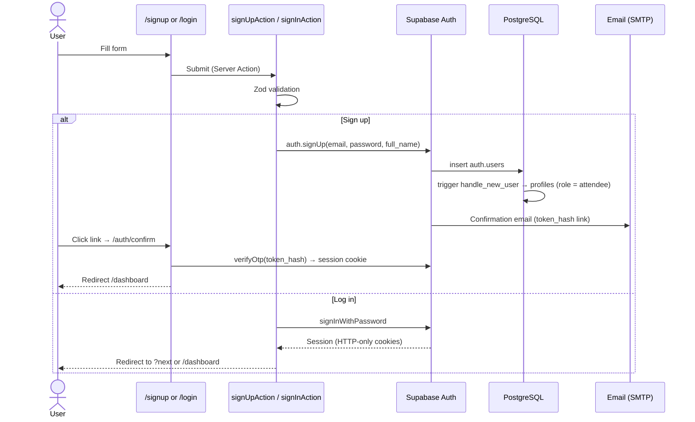
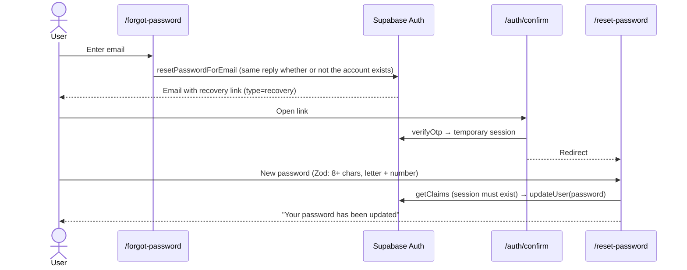
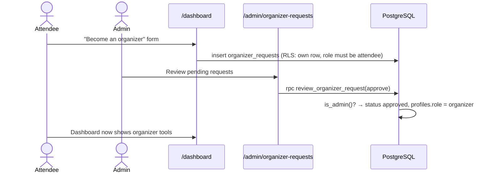
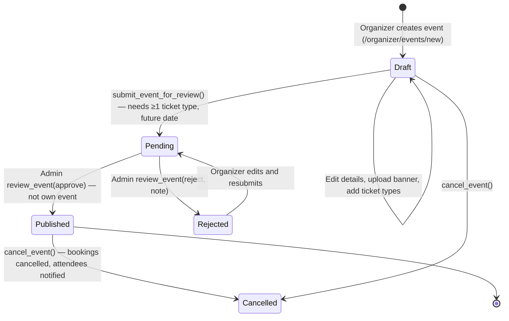
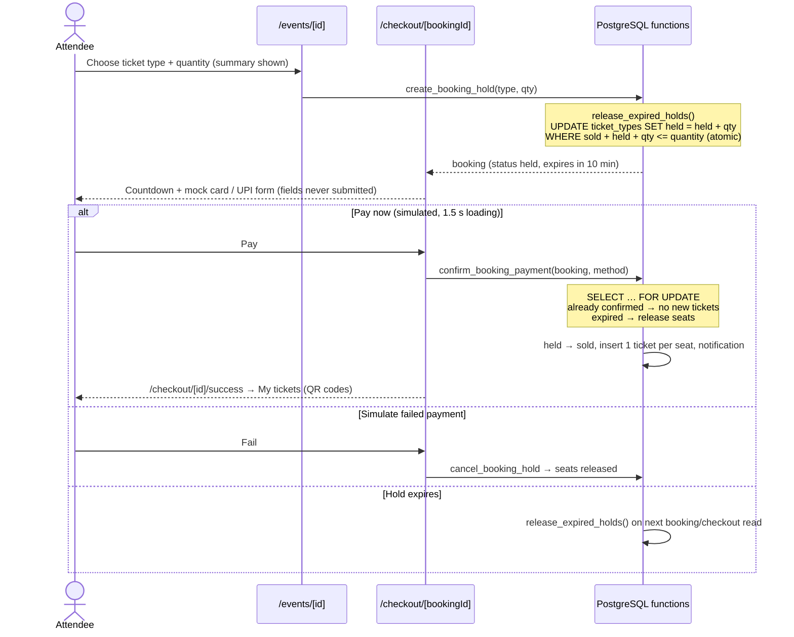
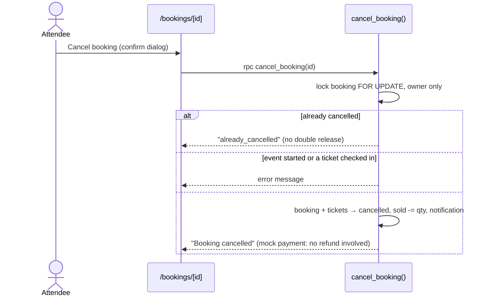
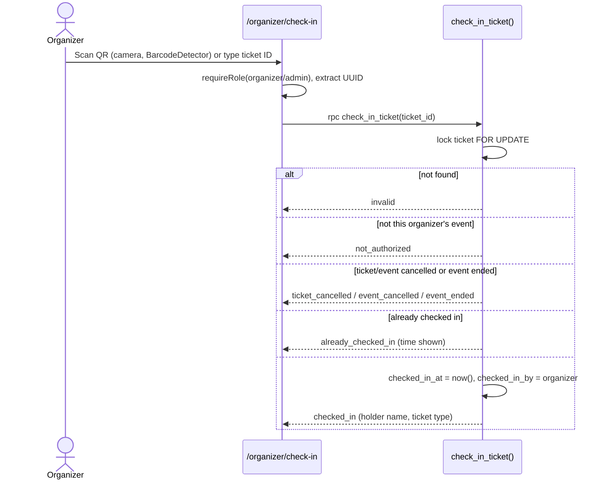

# Workflow diagrams

All seven flows required by the brief. Each box names the real page, Server
Action or database function in this repository.

## 1. Sign up and login

## 2. Forgot / reset password

## 3. Organizer approval

## 4. Event creation and publishing

## 5. Ticket booking (select → hold → mock payment → confirm → ticket)

## 6. Booking cancellation

Event cancellation (`cancel_event`) cancels every booking and ticket for the
event, releases all inventory and sends each attendee an in-app notification.

## 7. QR check-in

